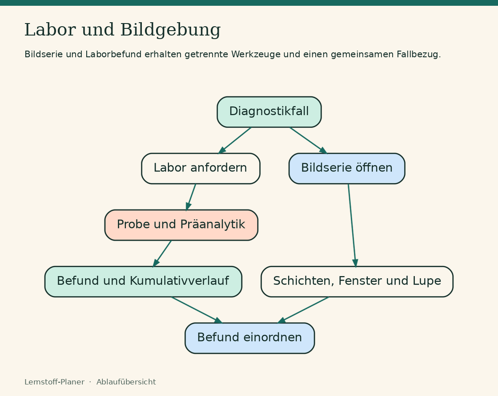

# Diagnostik: Labor und Bildgebung

**Räume:** Jeder Fall hat ein Raumfoto aus dem gemeinsamen Baustein (`src/ui/sim/raeume`, siehe [RAEUME.md](RAEUME.md)). Die Hotspots führen in den passenden Reiter. Im Sepsis-Fall muss erst der Monitor angeschlossen werden (Raum 12a → 12). In zwei Fällen rutscht nach einiger Zeit der Fingersensor ab: SpO₂ fällt aus, EKG und Blutdruck laufen weiter.

Seite `#/lernen/diagnostik` (Fälle, Lernmodus „Befund lesen“, eigene Bilder) und Labor-Trainer `#/lernen/labor`.

## Bausteine (für alle Simulatoren)

| Ort | Inhalt |
| --- | --- |
| `src/ui/sim/bildgebung/phantom.ts` | Synthetische CT-Schichten (Rohwert = HU + 1024) und Röntgen-Thorax, Varianten Pneumonie, Lungenembolie (CT-Angio), Pneumothorax, Erguss, Stauung. Deterministisch, offline. |
| `src/ui/sim/bildgebung/serie.ts` | Bildserie: `phantom`, `bilder` (öffentlich, nur mit Lizenz/Urheber/Quelle) oder `material` (privates Material-Repo). Befundmarken normiert 0..1. |
| `src/ui/sim/bildgebung/BildBetrachter.tsx` | Schichten blättern (Wischen, Rad, Pfeiltasten, Regler), Fenster (Vorgaben, Wischen), Lupe mit HU-Messwert, Markieren, Vollbild, Invertieren. Bei „Bewegung reduzieren“ kein Abspielen. |
| `src/ui/sim/labor/parameter.ts` | Laborparameter mit Referenz, kritischen Grenzen, Material, Laufzeit, Pflegebedeutung. |
| `src/ui/sim/labor/praeanalytik.ts` | Röhrchen (Farben Europa/international), Abnahmereihenfolge, Fehler: Identität, Hämolyse, Stauung, Infusionsarm, EDTA-Verschleppung, Citrat unterfüllt, Liegezeit, Blutkultur nach Antibiose. |
| `src/ui/sim/labor/modell.ts` | Werte aus Verlauf (Basis, Drift pro Stunde, Grenze, Therapie-Flags mit Zielwert und Zeitkonstante), Auftrag → Ergebnis mit Transport und Laufzeit, kritische Anrufe, Kumulativbefund. |
| `src/ui/sim/labor/bga.ts` | BGA-Deutung in Schritten. |
| `src/ui/sim/labor/LaborTafel.tsx` | Kumulativbefund mit Kennzeichen und Mini-Verlauf. |

Praxis- und Fallsimulator können diese Bausteine direkt nutzen (z. B. `labResult` als echter Befund statt Text).

## Neuer Fall

Eintrag in `src/features/diagnostik/faelle.ts` (Format `typen.ts`). `faelle.test.ts` prüft: bekannte Parameter,
Therapie-Flags passen zu Anordnungen, Fragen verweisen auf vorhandene Befunde, BGA-Lösung stimmt mit der Deutung
überein, und jede Befundmarke liegt dort, wo sich das Phantom vom Normalbefund unterscheidet.

**Kinderprofile (Audit SIM-01):** Die Altersgruppe kommt aus dem Alter (`altersgruppe` bzw. `monitorGruppe`:
unter 1 Jahr Säugling, unter 6 Kleinkind, unter 14 Schulkind, sonst Erwachsene).

- *Labor* (`parameter.ts`): `kind` ist je Parameter entweder ein Bereich je Altersgruppe (Leukozyten, Hb,
  Kreatinin, Harnstoff) oder `'wie-erwachsen'`, wenn der Erwachsenenbereich ab 1 Jahr übernommen werden darf
  (Elektrolyte, BGA, BZ, CRP/PCT, Gerinnung, Thrombozyten, Urin-Stix, Blutkultur). Fehlt `kind`, wertet die App
  Kinderwerte **nicht** automatisch: Flag `unbewertet` („?“), kein kritischer Anruf, Referenz „kein Kinderprofil“.
  Säuglinge haben bisher gar kein Profil. Unter der Tafel stehen Profil und Herkunft (`KINDERPROFIL_QUELLE`).
- *Monitor* (`monitor.ts`): `alarmStufe(p, n, gruppe)` und `gesamtAlarm(w, gruppe)` nutzen für Kleinkind und
  Schulkind eigene Grenzen für Puls, Atemfrequenz und systolischen Druck, SpO₂ und Temperatur wie bei
  Erwachsenen. `alarmProfil(gruppe)` liefert Label und Quelle für die Anzeige, `normBand` die Bänder der
  Verlaufskurven. Säuglinge: keine Färbung, „kein Profil“ am Monitor.
- Alle Werte sind didaktische Richtwerte, gerundet und fachlich ungeprüft; lokale Grenzen gehen vor.

Fälle: Asthmaanfall beim Schulkind (Max, 8 J., Raum 21; Monitor rot wegen SpO₂ 90 %, AF 34 gelb) und Exsikkose
beim Kleinkind (Mia, 2 J., Raum 20; Puls 156 gelb, Kreatinin 0,7 nach Kinderprofil erhöht).

## Echte Bilder

- **Öffentlich** (`public/bildgebung/…`, Quelle `bilder`): nur frei lizenziert (CC BY, CC BY-SA, gemeinfrei) mit Urheber,
  Lizenz und Quell-URL. Keine Daten aus zugangsbeschränkten Datensätzen (MIMIC-IV/MIMIC-CXR), keine Bilder mit unklarer
  Lizenz (MedPix je Bild prüfen). CC BY-NC-SA (z. B. Radiopaedia) passt, solange die App kostenlos und
  nicht kommerziell bleibt; Änderungen (Zuschnitt, Verkleinerung) werden unter dem Bild genannt.
- **Bisher eingebunden:** zwei Röntgenbilder aus Radiopaedia (CC BY-NC-SA 3.0), bezogen über den offenen Datensatz
  [ieee8023/covid-chestxray-dataset](https://github.com/ieee8023/covid-chestxray-dataset), dessen `metadata.csv` Lizenz
  und Urheber je Bild nennt: Pneumonie rechts (Gaillard, rID 11009) und Pleuraerguss links (Knipe, rID 44224).
  Wikimedia Commons war aus der Entwicklungsumgebung nicht abrufbar (Drosselung).
- **Von Philipp geliefert (2026-11-11, Materialliste):** Spontanpneumothorax links (Hellerhoff, Wikimedia Commons,
  CC BY-SA 3.0, als JPEG gespeichert) und eine CT-Pulmonalisangiographie aus CAD-PE Fall 001 (Germán González Serrano,
  über das CADS-Dataset, CC BY 4.0): 32 axiale Schichten à 1 mm, oben und unten beschnitten. Beide Befundmarken sind
  fachlich noch ungeprüft.
- **CT als 16-Bit-PNG:** Pixelwert = HU + 1024 (wie die Rohwerte der Phantome). `dekodierePng16` in `serie.ts` liest
  solche Dateien verlustfrei (eigener PNG-Dekoder mit `DecompressionStream`), damit Fenster und HU-Messung echt sind.
  Andere CT-Bilder (8 Bit) laufen weiter über den normalen Bildpfad. `public/bildgebung/` wird nicht vorab gecacht,
  sondern beim ersten Ansehen (CacheFirst).
- Befunde im echten Bild tragen dieselbe ID wie im synthetischen Bild; ein Test prüft Lizenzfelder, Dateien und IDs.
- **Privat** (Material-Repo, Ordner `bildgebung/<name>/serie.json` + Bilder): z. B. Unterrichtsmaterial. Die App lädt
  sie nur mit dem Zugang unter Material → Große Dateien auf dem Gerät, nie in den öffentlichen Build.

## Labor-Werkbank (`#/lernen/labor?modus=werkbank`)

Drei interaktive Stationen neben den Quizrunden des Labor-Trainers, als eigener Chunk nachgeladen
(`src/features/labortrainer/werkbank`). Die Logik liegt in reinen Modulen mit Tests
(`entnahme.ts`, `verlauf.ts`, `meldung.ts`, `werkbank.test.ts`).

- **Blutentnahme:** Identität, Arm (Infusionsarm sichtbar), Stauen mit laufender Stauzeit (Warnung über 60 s), Röhrchen in selbst gewählter Reihenfolge in den Halter stecken, Füllanimation durch das Vakuum (bei „Bewegung reduzieren“ sofort voll), Flügelkanüle mit Verwurfröhrchen, mischen, Transport. Der Befund zeigt wahre und gemessene Werte; Fehlerregeln aus `src/ui/sim/labor/praeanalytik.ts`.
- **Kumulativbefund:** Verlauf über mehrere Tage in der `LaborTafel`, den entscheidenden Wert wählen, dann zeichnet sich die Kurve mit Referenzband, danach Handlungsfrage.
- **Kritischer Wert:** Anruf des Labors, zurücklesen, Telefonnotiz, SBAR-Meldung aus Bausteinen (Reihenfolge und Unwichtiges werden bewertet), richtig handeln bis zum ärztlichen Eintreffen.

Alle Fälle sind fiktiv und fachlich ungeprüft vereinfacht.

## Messen, geführte Befundung, Vergleich (Bildbetrachter)

- **Strecke** (`↔`): Länge in mm; Phantome haben ein festes Bildfeld (CT 360 mm, Röntgen 430 mm), echte Bilder nur mit `pixelMm` an der Serie, sonst Pixel. **Messkreis** (`⊙`): Mittelwert, Streuung in HU mit grober Deutung (Luft, Lunge, Wasser, Weichteil, Kontrast, Knochen). Rechnungen in `src/ui/sim/bildgebung/messen.ts`.
- **Hervorhebung:** `BildBetrachter` nimmt `hervorhebung` (normierter Bereich) und `werkzeugVorschlag`; der Rahmen wandert animiert (bei „Bewegung reduzieren“ ohne Animation).
- **Röntgen systematisch** (`#/lernen/diagnostik?modus=befundung`): Technik, A Atemweg, B Lunge und Pleura, C Herz mit eigener Messung des Herz-Thorax-Quotienten, D Zwerchfell, E Rest, Gesamtbild. Schritte je Phantom-Variante in `befundung.ts` (gemeinsamer Baustein, auch für andere Module nutzbar).
- **Nebeneinander:** In Fällen mit echtem Vergleichsbild zeigt „Nebeneinander“ synthetisches und echtes Bild gleichzeitig.

## Verläufe, Zeitleiste, neue Fälle

- **Verlaufskurve** (`src/ui/sim/labor/VerlaufKurve.tsx`, gemeinsamer Baustein): animierte Linie mit Referenzband und Ereignismarken. Im Labor-Reiter jedes Falls („Verlauf als Kurve“, Marken = eigene Maßnahmen) und in der Labor-Werkbank.
- **Auswertung „Dein Ablauf“:** `zeitleiste(lauf, fall)` baut aus Aufträgen, Befundzeiten, Anrufen, Meldungen, Untersuchungen, Maßnahmen und eigenen Notizen eine Zeitleiste; `vitalReihe` zeigt Puls, Blutdruck, SpO₂ und Atemfrequenz über den Fall mit den Maßnahmen als Marken.
- **Neue Fälle:** `gi-blutung` (Hb-Verlauf, Harnstoff, Kreuzblut vor EK), `hyperkaliaemie` (Kalium-Verlauf, Bradykardie, Calcium vor Glukose-Insulin, BGA), `akutes-nierenversagen` (Kreatinin-Verlauf, Oligurie, Röntgen mit Überwässerung, Zufuhr stoppen vor Diuretikum).
